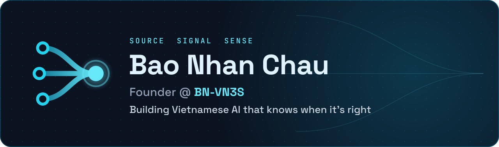
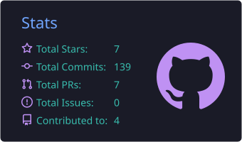
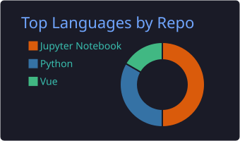
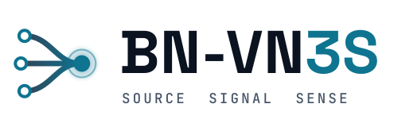

<!-- GitHub profile README for chaubaonhan/chaubaonhan -->

  
  
  
  

 

## 🧠 About

- 🔬 &nbsp;Researching **Vietnamese NLP**, **temporal adaptation**, and **evidence-aware QA**
- 🚀 &nbsp;Building **BN-VN3S** — an AI lab turning language research into dependable tools
- 🏢 &nbsp;Shipped an enterprise **RAG assistant** for ~5,000 employees, end to end
- 📍 &nbsp;Ho Chi Minh City, Vietnam

## 📄 Research

| | Project | Venue |
| :---: | :--- | :--- |
| 📰 | **BN-VN3S** — 946K Vietnamese news articles, 10 topics, 2019–2025  1st author |  |
| ⏳ | **DART-VTC** — drift-aware replay for future-year classification  1st author |  |
| 🎓 | **ViSAQA** — QA benchmark for answerability & abstention  Co-author |   |

## 🛠️ Tech Stack

  

  
  
  
  
  

## 📊 GitHub Stats

  
  

 

<picture>
  <source media="(prefers-color-scheme: dark)" srcset="./assets/bnvn3s-logo-dark.svg" />
  
</picture>

Open to research collaborations & applied AI projects 🤝

